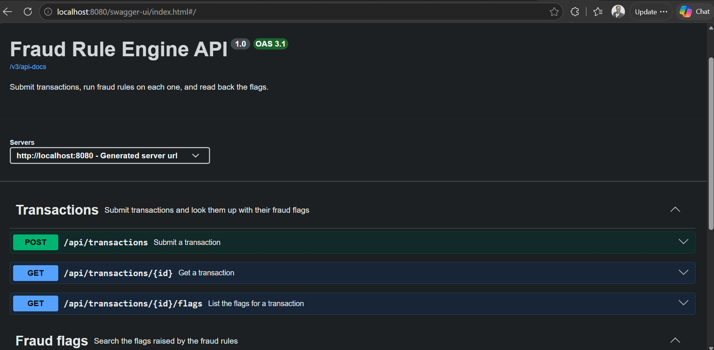
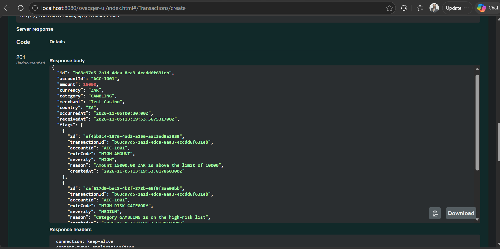

# Fraud Rule Engine Service

A Java back-end service that checks card transactions for fraud. You send it a transaction, it runs four fraud rules on it, saves a flag for every rule that is broken, and sends back the transaction with its flags.

Built with Java 21 and Spring Boot 4. The data is stored in an H2 database file, so nothing extra has to be installed.

## What you need

- Java 21 (check with `java -version`)
- Git
- Docker Desktop (only if you want to run it in Docker)

## Get the code

1. Open a terminal.
2. Download the project:

```bash
git clone https://github.com/AnitaDaniel77/fraud-rule-engine.git
```

3. Go into the project folder:

```bash
cd fraud-rule-engine
```

Everything is now in that folder. All paths below are relative to it.

- `src/main/java/com/anitadaniel/fraudengine/` the service code
- `src/main/java/com/anitadaniel/fraudengine/controller/` the REST endpoints
- `src/main/java/com/anitadaniel/fraudengine/rule/` the four fraud rules
- `src/main/java/com/anitadaniel/fraudengine/service/` the fraud check and the lookups
- `src/main/resources/application.properties` the settings and rule limits
- `src/test/java/com/anitadaniel/fraudengine/` the automated tests
- `docs/ERD.md` the database diagram
- `docs/images/` the screenshots used in this README
- `Dockerfile` the Docker build
- `.github/workflows/ci.yml` the automatic checks on GitHub
- `pom.xml` the Maven build file and the list of libraries
- `target/fraud-rule-engine-0.0.1-SNAPSHOT.jar` the built jar, created by `./mvnw clean package`
- `data/fraud.mv.db` the database file, created on the first run

## Run the service

1. In the project folder, start it:

```bash
./mvnw spring-boot:run
```

On Windows Command Prompt use `mvnw.cmd spring-boot:run` instead.

2. Wait until the log shows `Started FraudRuleEngineApplication`.
3. Check it is alive by opening `http://localhost:8080/actuator/health` in a browser. It should include `"status":"UP"`.
4. Stop it any time with Ctrl+C.

## Try it

Swagger UI is a web page that lets you use the API without writing any code.

1. Open `http://localhost:8080/swagger-ui.html`.
2. Click **POST /api/transactions**, then **Try it out**.
3. Replace the example body with this one:

```json
{
  "accountId": "ACC-1001",
  "amount": 15000,
  "currency": "ZAR",
  "category": "GAMBLING",
  "merchant": "Test Casino",
  "country": "ZA",
  "occurredAt": "2026-11-05T00:30:00Z"
}
```

4. Click **Execute**. The response is 201 and lists three flags: the amount is above 10000, the category is on the watch list, and the time is 02:30 South African time.
5. Copy the `id` from the response. Open **GET /api/transactions/{id}**, click **Try it out**, paste the id and click **Execute** to read the transaction back.
6. Open **GET /api/flags** to list every flag. You can fill in `accountId` or `ruleCode` to filter.

Example response:

```json
{
  "id": "b63c97d5-2a1d-4dca-8ea3-4ccdd6f631eb",
  "accountId": "ACC-1001",
  "amount": 15000.00,
  "currency": "ZAR",
  "category": "GAMBLING",
  "merchant": "Test Casino",
  "country": "ZA",
  "occurredAt": "2026-11-05T00:30:00Z",
  "receivedAt": "2026-11-05T13:19:53.567531700Z",
  "flags": [
    {
      "id": "ef4bb3c4-1976-4ad3-a256-aac3ad9a3939",
      "transactionId": "b63c97d5-2a1d-4dca-8ea3-4ccdd6f631eb",
      "accountId": "ACC-1001",
      "ruleCode": "HIGH_AMOUNT",
      "severity": "HIGH",
      "reason": "Amount 15000.00 ZAR is above the limit of 10000",
      "createdAt": "2026-11-05T13:19:53.817860300Z"
    },
    {
      "id": "caf617d0-bec8-4b8f-878b-66f9f3ae03bb",
      "transactionId": "b63c97d5-2a1d-4dca-8ea3-4ccdd6f631eb",
      "accountId": "ACC-1001",
      "ruleCode": "HIGH_RISK_CATEGORY",
      "severity": "MEDIUM",
      "reason": "Category GAMBLING is on the high-risk list",
      "createdAt": "2026-11-05T13:19:53.817860300Z"
    },
    {
      "id": "a620a578-90f8-44b0-b336-b63128b07d83",
      "transactionId": "b63c97d5-2a1d-4dca-8ea3-4ccdd6f631eb",
      "accountId": "ACC-1001",
      "ruleCode": "UNUSUAL_HOUR",
      "severity": "LOW",
      "reason": "Amount 15000.00 spent at 2:00",
      "createdAt": "2026-11-05T13:19:53.817860300Z"
    }
  ]
}
```





## Where the data is

The service saves to a file called `fraud.mv.db` in a `data` folder inside the project. It is created on the first run and kept between runs. To start with an empty database, stop the service and delete the `data` folder.

## Run it in Docker

1. Start Docker Desktop.
2. Build the image:

```bash
docker build -t fraud-rule-engine .
```

3. Run it:

```bash
docker run --rm -p 8080:8080 -v fraud-data:/app/data fraud-rule-engine
```

4. Open `http://localhost:8080/swagger-ui.html` as above.
5. Stop it with Ctrl+C. The data stays in the `fraud-data` volume. To wipe it, run `docker volume rm fraud-data`.

If the build fails with a certificate error (`PKIX path building failed`), the network is inspecting secure traffic, which some company networks do. Build on a different network.

## Run the tests

```bash
./mvnw test
```

There are 19 tests. Fifteen test the four rules one by one, including the edge cases (an amount exactly at the limit, the end of the night window, South African time against UTC). Three call the running service over HTTP: a 201 with a flag, a 400 for a bad request, and a 404 for an unknown id. One checks that the application starts. GitHub Actions also runs the tests, builds the Docker image and checks the health endpoint on every push.

## The fraud rules

- HIGH_AMOUNT (severity HIGH): the amount is above 10000.
- HIGH_RISK_CATEGORY (severity MEDIUM): the category is GAMBLING or CRYPTO.
- UNUSUAL_HOUR (severity LOW): the amount is 2000 or more and the purchase was between 01:00 and 03:59 South African time.
- VELOCITY (severity HIGH): the account has more than 5 transactions within 10 minutes.

Each rule is its own class that implements the `FraudRule` interface. Spring picks them all up automatically, so adding a rule means adding one class. The limits can be changed in `application.properties`.

## The endpoints

- POST /api/transactions: submit a transaction. Returns 201, or 400 if the body is not valid.
- GET /api/transactions/{id}: one transaction with its flags. Returns 404 if the id is unknown.
- GET /api/transactions/{id}/flags: the flags for one transaction. Returns 404 if the id is unknown.
- GET /api/flags: all flags, optionally filtered with `?accountId=` and `?ruleCode=`.

Errors come back as JSON with a status, a message and a list of field problems.

## Design notes

- Amounts use `BigDecimal` with two decimal places, never `double`, so money stays exact.
- Requests and responses are separate classes, so database entities are never exposed directly.
- A transaction and its flags are saved together in one database transaction.
- All errors are handled in one class, so every endpoint fails in the same way.
- The database diagram is in `docs/ERD.md`.

## Known limits

- Amounts are compared as they are, with no currency conversion. The limits assume ZAR.
- There is no login and the flag search has no paging.
- Sending the same transaction twice creates two records.

## Licence

MIT, see the LICENSE file.